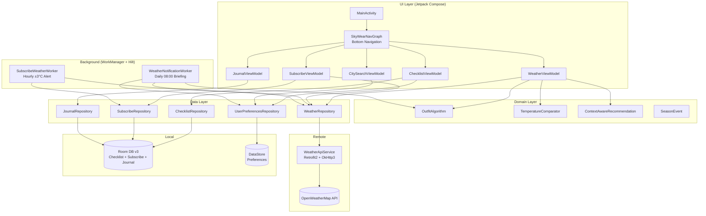

# SkyWear

**English** · [한국어](README_KO.md)

An Android travel app that compares the weather in a Korean city and a Japanese city and suggests what to wear, in 8 steps from T-shirt and shorts to a long puffer and hand warmers.
Seoul can be below freezing while Osaka is above 10°C, and I wanted one screen that tells you what to pack for the other side.

韓国と日本の都市の天気を比べて、服装を8段階で提案する Android の旅行アプリです。

## Features

- Current weather and 5-day forecast for the departure and destination cities side by side, with daily min/max
- Outfit suggestion in 8 steps, adjusted with wind chill and heat index
- A KR→JP / JP→KR switch that changes the cities, advice, checklist and seasonal events
- Travel checklist in Korean / English / Japanese
- Follow up to 5 cities, with a daily 08:00 briefing and an alert when the temperature changes by 3°C or more
- Seasonal events (8 in Japan, 8 in Korea) with a countdown
- Travel journal with the weather and what you wore
- Extra items for the destination (umbrella only when rain is forecast, hand warmers, windbreaker, ...)
- Korean / English / Japanese UI and dark mode

## Tech Stack

| Category | Stack |
| --- | --- |
| **Language** |    |
| **UI** |    |
| **Architecture** |   |
| **Network** |    |
| **Local Storage** |   |
| **Background** |  |
| **Monitoring** |  |
| **Testing** |  |
| **API** |  |

<details>
<summary>Versions</summary>

| Item | Version |
| --- | --- |
| Kotlin / KSP | `2.0.21 / 2.0.21-1.0.28` |
| Android Gradle Plugin / JDK | `8.9.1 / 21` |
| minSdk / targetSdk | `26 / 36` |
| Compose BOM / Material 3 | `2025.10.00 / 1.4.0` |
| Navigation Compose | `2.8.9` |
| Hilt / hilt-work | `2.51.1 / 1.2.0` |
| Retrofit / OkHttp | `2.11.0 / 4.12.0` |
| Room (DB schema) | `2.7.1 (v3)` |
| DataStore / WorkManager | `1.1.1 / 2.9.1` |
| Firebase BOM | `33.1.0` |

</details>


## Getting Started

1. Install JDK 21. Gradle picks it up via `gradle/gradle-daemon-jvm.properties`; in Android Studio, set *Settings > Build, Execution, Deployment > Build Tools > Gradle > Gradle JDK* to a JDK 21 (e.g. the bundled JetBrains Runtime).
2. Get a free API key from [OpenWeatherMap](https://openweathermap.org/api).
3. Add it to `SkyWear/local.properties` (exposed as `BuildConfig.WEATHER_API_KEY`):
   ```properties
   WEATHER_API_KEY=your_api_key_here
   ```
4. Place your Firebase `google-services.json` in `SkyWear/app/` (required by the Google Services / Crashlytics plugins).
5. Build and test:
   ```bash
   cd SkyWear
   ./gradlew assembleDebug
   ./gradlew testDebugUnitTest
   ```


## Architecture




## Problems I ran into

**1. KSP + Kotlin Version Compatibility**
- **Challenge**: The initial Kotlin 2.2.10 + KSP 2.2.10-2.0.2 setup failed to build with the Room compiler and the rest of the toolchain.
- **Resolution**: Aligned the toolchain to Kotlin `2.0.21` with the matching KSP `2.0.21-1.0.28` — the KSP version prefix must always equal the Kotlin version.

**2. Hilt — Missing `android:name` in AndroidManifest**
- **Challenge**: App crashed on launch with `Hilt Activity must be attached to an @HiltAndroidApp Application`.
- **Resolution**: Added `android:name=".SkyWearApplication"` to `<application>` tag in `AndroidManifest.xml`.

**3. ViewModel Instance Isolation Across Screens**
- **Challenge**: City selection in SearchScreen was not reflected in DashboardScreen — each screen created its own ViewModel instance via `hiltViewModel()`.
- **Resolution**: Elevated `hiltViewModel()` calls to NavGraph level and passed shared instances as parameters to each screen, ensuring a single source of truth.

**4. Travel Direction — Inverted Gap Degree Logic**
- **Challenge**: When direction was JP→KR and the destination (Korea) was colder, the app incorrectly advised "dress one layer lighter."
- **Root Cause**: `gapDegree` is always calculated as `jpTemp - krTemp`. The sign needed to be flipped for JP→KR direction to correctly represent the destination temperature delta.
- **Resolution**: Applied `directedGap = if (isKrToJp) gapDegree else -gapDegree` throughout comparison and advice logic.

**5. Compose i18n — `stringResource()` Context Constraint**
- **Challenge**: String generation for outfit recommendations and comparison messages was embedded in the Domain layer, making localization impossible since `stringResource()` requires a Composable context.
- **Resolution**: Removed all string generation from Domain layer. Created dedicated `@Composable` functions in the UI layer that call `stringResource()` directly.

**6. Room TypeConverter — Enum Persistence**
- **Challenge**: Room DB had no mechanism to store `ChecklistCategory` enum, risking a runtime crash on first checklist access.
- **Resolution**: Created `ChecklistConverters` class with `@TypeConverter` annotations for bidirectional `String ↔ ChecklistCategory` conversion.

**7. Dynamic City Name Localization**
- **Challenge**: OpenWeatherMap API always returns city names in English regardless of the `lang` parameter. Display names remained in English even when device language was set to Japanese.
- **Resolution**: Built `localizedCityName(nameEn: String)` lookup function in `CitySearchData.kt` that maps English API city names to native equivalents using a predefined city list.

**8. Forecast Date Filtering**
- **Challenge**: Past dates remained visible in forecast date selector tabs after midnight.
- **Resolution**: Added `.filter { it >= today }` with a renamed lambda parameter (`key`) to avoid shadowing the `dateKey()` extension function. "Today" is now computed in the city's time zone (see #17).

**9. Daily Min/Max Temperature Reliability**
- **Challenge**: A single 12:00 forecast slot showed high variability — a day might have a warm afternoon but a cold evening, making outfit advice misleading.
- **Resolution**: Extracted `minOf` and `maxOf` across all available 3-hour slots per day using `dailyRepresentativeWithTime()`, returning a `Triple` of (representative slot, time, min/max pair).

**10. Room DB Schema Evolution**
- **Challenge**: Adding `SubscribedCity` and `TravelJournal` entities required a safe migration path without data loss.
- **Resolution**: Implemented `MIGRATION_2_3` with explicit `CREATE TABLE IF NOT EXISTS` SQL statements, maintaining clean incremental migration from v1 → v2 → v3.

**11. Responsive Layout — White Space on Larger Screens**
- **Challenge**: Fixed padding (16dp) and `displayMedium` font caused excessive white space on larger phones.
- **Resolution**: Reduced vertical padding to 8dp, switched temperature display to `displaySmall`, and tightened card spacing from 16dp to 10dp across all screens.

**12. Silent Notifications on Android 13+**
- **Challenge**: `POST_NOTIFICATIONS` was declared in the manifest but never requested, so both workers ran successfully while every notification was silently dropped (targetSdk 36).
- **Resolution**: Request the runtime permission once on first launch, and attach a `PendingIntent` so tapping a notification opens the app.

**13. OkHttp Interceptor Connection Leak**
- **Challenge**: `NetworkInterceptor` threw a custom exception on non-200 responses without closing the response body, leaking connections.
- **Resolution**: Return any 2xx as-is, `close()` the response before mapping the status code to a `NetworkException`, and map exceptions to localized string resources in the UI.

**14. `stateIn` Initial Value Trap**
- **Challenge**: `SubscribeViewModel` refreshed weather in `init` by reading `subscribedCities.value`, which is always the empty initial value of `stateIn(WhileSubscribed)` — no weather loaded until the user tapped refresh.
- **Resolution**: Read the source flow directly with `repository.getAllCities().first()`.

**15. Duplicate API Calls from Screen-scoped ViewModels**
- **Challenge**: The Season tab called `hiltViewModel()` for its own `WeatherViewModel`, re-running 4 weather/forecast requests every time the tab opened just to read the travel direction.
- **Resolution**: Pass the NavGraph-level shared instance (same lesson as #3).

**16. Checklist Defaults Deleted Permanently**
- **Challenge**: "Delete checked items" also removed seeded default items, which are only inserted in `RoomDatabase.Callback.onCreate` and could not be restored.
- **Resolution**: Delete only custom items and uncheck defaults in a single `@Transaction`, behind a confirmation dialog.

**17. Forecast Shifted by 9 Hours (UTC `dt_txt`)**
- **Challenge**: The forecast API's `dt_txt` is UTC, but it was parsed as local time. In KR/JP (UTC+9) the "12:00" representative slot was really 21:00 and each day was split at 09:00 local.
- **Resolution**: Derive date key, date label and time label from `dt` plus the city's `timezone` offset with `java.time`, and round daily min/max instead of truncating.

**18. Stale Responses Overwriting New Ones**
- **Challenge**: Each refresh or city change launched new coroutines without cancelling the old ones, so a slower earlier request could overwrite the dashboard with the previous city.
- **Resolution**: Keep the in-flight `Job`s and cancel them before fetching again; reset the selected forecast date when it disappears from the new result.

**19. `runCatching` Swallowing Cancellation**
- **Challenge**: `runCatching` and `catch (e: Exception)` also caught `CancellationException`, turning cancelled requests into error states and stopped workers into retries.
- **Resolution**: Wrap API calls with `apiResult`, which rethrows cancellation, and fetch KR/JP in parallel with `async` as the code comments intended.

**20. Machine-specific `org.gradle.java.home`**
- **Challenge**: `gradle.properties` pinned the JDK to a local Android Studio path, so the project could not build on another machine or CI.
- **Resolution**: Remove it and rely on `gradle-daemon-jvm.properties` (JDK 21) and `jvmToolchain(21)`.


## Numbers

- 50 JVM unit tests (outfit logic, feels-like correction, forecast aggregation, city search, input validation), 0 Android Lint errors
- All screens translated into Korean, English and Japanese
- Room DB v3 with migrations from v1, Firebase Crashlytics in release builds only

## Contact

hkys1223@gmail.com
