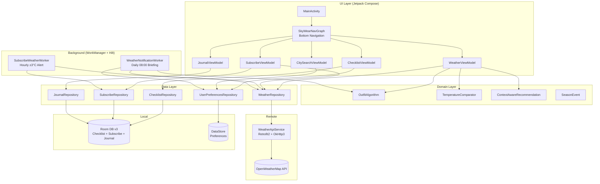

# SkyWear

[English](README.md) · **한국어**

한국 도시와 일본 도시의 날씨를 비교해서, 반팔·반바지부터 롱패딩·핫팩까지 옷차림을 8단계로 추천하는 Android 여행 앱입니다.
서울은 영하인데 오사카는 10°C가 넘는 날도 있어서, 상대 나라에 뭘 입고 가야 할지 한 화면에서 보고 싶어서 만들었습니다.

## 기능

- 출발 도시와 도착 도시의 현재 날씨, 5일 예보를 나란히 표시 (일별 최저/최고 기온)
- 체감온도(Wind Chill, Heat Index)를 반영한 8단계 옷차림 추천
- 한국→일본 / 일본→한국 전환 스위치 (도시, 조언, 체크리스트, 계절 이벤트가 같이 바뀜)
- 한국어·영어·일본어 여행 체크리스트
- 도시 최대 5개 구독, 매일 08:00 브리핑과 3°C 이상 기온 변화 알림
- 한일 계절 이벤트 각 8개와 D-day
- 날씨와 옷차림을 남기는 여행 일지
- 목적지에 맞는 준비물 (비 예보일 때만 우산, 핫팩, 바람막이 등)
- 한국어·영어·일본어 UI, 다크 모드

## 기술 스택

| 분류 | 기술 |
| --- | --- |
| **언어** |    |
| **UI** |    |
| **아키텍처** |   |
| **네트워크** |    |
| **로컬 저장소** |   |
| **백그라운드** |  |
| **모니터링** |  |
| **테스트** |  |
| **API** |  |

<details>
<summary>주요 버전</summary>

| 항목 | 버전 |
| --- | --- |
| Kotlin / KSP | `2.0.21 / 2.0.21-1.0.28` |
| Android Gradle Plugin / JDK | `8.9.1 / 21` |
| minSdk / targetSdk | `26 / 36` |
| Compose BOM / Material 3 | `2025.10.00 / 1.4.0` |
| Navigation Compose | `2.8.9` |
| Hilt / hilt-work | `2.51.1 / 1.2.0` |
| Retrofit / OkHttp | `2.11.0 / 4.12.0` |
| Room (DB 스키마) | `2.7.1 (v3)` |
| DataStore / WorkManager | `1.1.1 / 2.9.1` |
| Firebase BOM | `33.1.0` |

</details>


## 실행 방법

1. JDK 21을 설치합니다. Gradle은 `gradle/gradle-daemon-jvm.properties`로 JDK 21을 찾고, Android Studio에서는 *Settings > Build, Execution, Deployment > Build Tools > Gradle > Gradle JDK*를 JDK 21(예: 내장 JetBrains Runtime)로 지정합니다.
2. [OpenWeatherMap](https://openweathermap.org/api)에서 무료 API 키를 발급받습니다.
3. `SkyWear/local.properties`에 추가합니다 (`BuildConfig.WEATHER_API_KEY`로 주입됨):
   ```properties
   WEATHER_API_KEY=your_api_key_here
   ```
4. Firebase `google-services.json`을 `SkyWear/app/`에 넣습니다 (Google Services / Crashlytics 플러그인 필수).
5. 빌드 및 테스트:
   ```bash
   cd SkyWear
   ./gradlew assembleDebug
   ./gradlew testDebugUnitTest
   ```


## 아키텍처




## 겪었던 문제들

**1. KSP + Kotlin 버전 호환성**
- **문제**: 초기 Kotlin 2.2.10 + KSP 2.2.10-2.0.2 조합이 Room Compiler 및 툴체인과 맞지 않아 빌드 실패.
- **해결**: Kotlin `2.0.21`과 이에 대응하는 KSP `2.0.21-1.0.28`로 툴체인 정렬. KSP 버전 앞자리는 항상 Kotlin 버전과 같아야 함.

**2. Hilt — AndroidManifest `android:name` 누락**
- **문제**: 앱 실행 시 `Hilt Activity must be attached to an @HiltAndroidApp Application` 크래시.
- **해결**: `AndroidManifest.xml`의 `<application>` 태그에 `android:name=".SkyWearApplication"` 추가.

**3. 화면 간 ViewModel 인스턴스 격리**
- **문제**: SearchScreen에서 도시를 변경해도 DashboardScreen에 반영되지 않음.
- **근본 원인**: 각 화면이 `hiltViewModel()`로 별도 인스턴스를 생성했기 때문.
- **해결**: `hiltViewModel()` 호출을 NavGraph 레벨로 끌어올리고 공유 인스턴스를 파라미터로 전달.

**4. 여행 방향 — gapDegree 부호 반전 로직**
- **문제**: JP→KR 방향에서 목적지(한국)가 더 추운데 "한 겹 가볍게 입으세요"라고 잘못 출력.
- **근본 원인**: `gapDegree`는 항상 `jpTemp - krTemp`로 계산되므로 JP→KR 방향에서 부호 반전 필요.
- **해결**: `directedGap = if (isKrToJp) gapDegree else -gapDegree` 적용.

**5. Compose i18n — `stringResource()` 컨텍스트 제약**
- **문제**: 코디 추천·비교 메시지 문자열 생성이 Domain 레이어에 내장되어 현지화 불가.
- **해결**: Domain 레이어에서 모든 문자열 생성 제거. UI 레이어에 `@Composable` 함수로 이동.

**6. Room TypeConverter — Enum 영속성**
- **문제**: Room DB가 `ChecklistCategory` enum을 저장하는 방법을 몰라 런타임 크래시 가능성.
- **해결**: `@TypeConverter` 어노테이션으로 `String ↔ ChecklistCategory` 양방향 변환 클래스 생성.

**7. 동적 도시명 현지화**
- **문제**: OpenWeatherMap API는 `lang` 파라미터와 관계없이 도시명을 항상 영어로 반환.
- **해결**: `CitySearchData.kt`에 `localizedCityName(nameEn)` 조회 함수 구현. 영어 API 응답 → 현지어 매핑.

**8. 예보 날짜 필터링**
- **문제**: 자정이 지나도 과거 날짜가 예보 날짜 선택 탭에 남아있음.
- **해결**: `.filter { it >= today }`로 오늘 이전 날짜 필터링. 람다 파라미터명 충돌(`dateKey` → `key`)도 함께 수정. "오늘"은 이제 도시 시간대 기준으로 계산 (#17 참고).

**9. 일별 최저/최고 온도 신뢰도**
- **문제**: 12시 단일 슬롯은 하루 온도 변동성이 커서 코디 조언에 오해를 줄 수 있음.
- **해결**: `dailyRepresentativeWithTime()`으로 하루 전체 슬롯에서 `minOf`/`maxOf` 추출. `Triple`로 대표슬롯·시간·최저/최고 쌍 반환.

**10. Room DB 스키마 진화**
- **문제**: `SubscribedCity`, `TravelJournal` 엔티티 추가 시 기존 데이터 손실 없는 마이그레이션 필요.
- **해결**: `MIGRATION_2_3`에 명시적 `CREATE TABLE IF NOT EXISTS` SQL 구문으로 v1→v2→v3 증분 마이그레이션 구현.

**11. 반응형 레이아웃**
- **문제**: 레이아웃에 공백이 많아지고 보기가 불편해짐.
- **해결**: 고정 패딩 16dp→8dp 축소, `displayMedium`→`displaySmall` 전환, 카드 간격 10dp로 통일.

**12. Android 13+에서 알림이 표시되지 않음**
- **문제**: 매니페스트에 `POST_NOTIFICATIONS`를 선언만 하고 런타임 권한을 요청하지 않아, 워커는 정상 동작해도 알림이 조용히 차단됨 (targetSdk 36).
- **해결**: 첫 실행 시 권한을 한 번 요청하고, 알림 탭 시 앱이 열리도록 `PendingIntent` 연결.

**13. OkHttp Interceptor 커넥션 누수**
- **문제**: `NetworkInterceptor`가 200이 아닌 응답에서 response body를 닫지 않고 예외를 던져 커넥션이 누수됨.
- **해결**: 2xx는 그대로 반환하고, 상태 코드를 `NetworkException`으로 매핑하기 전에 `close()` 호출. 예외는 UI에서 현지화된 문자열 리소스로 변환.

**14. `stateIn` 초기값 함정**
- **문제**: `SubscribeViewModel`이 `init`에서 `subscribedCities.value`를 읽어 날씨를 갱신했는데, `stateIn(WhileSubscribed)`의 초기값은 항상 빈 리스트라 새로고침 전까지 날씨가 로드되지 않음.
- **해결**: `repository.getAllCities().first()`로 원본 Flow를 직접 조회.

**15. 화면 단위 ViewModel로 인한 API 중복 호출**
- **문제**: 시즌 탭이 `hiltViewModel()`로 별도 `WeatherViewModel`을 만들어, 여행 방향 하나를 읽으려고 탭을 열 때마다 날씨·예보 API 4회를 다시 호출함.
- **해결**: NavGraph 레벨의 공유 인스턴스를 전달 (#3과 같은 교훈).

**16. 체크리스트 기본 항목 영구 삭제**
- **문제**: "완료 항목 삭제"가 기본 항목까지 지웠는데, 기본 항목은 `RoomDatabase.Callback.onCreate`에서만 생성돼 복구 불가.
- **해결**: 커스텀 항목만 삭제하고 기본 항목은 체크 해제하도록 하나의 `@Transaction`으로 처리, 실행 전 확인 다이얼로그 추가.

**17. 예보가 9시간 밀려 표시됨 (UTC `dt_txt`)**
- **문제**: 예보 API의 `dt_txt`는 UTC인데 현지 시각처럼 사용함. KR/JP(UTC+9)에서는 "12:00" 대표 슬롯이 실제로는 21:00이었고, 하루가 현지 09:00 기준으로 나뉨.
- **해결**: `dt`와 도시의 `timezone` 오프셋으로 날짜 키·날짜 라벨·시간 라벨을 `java.time`으로 계산하고, 일별 최저/최고는 절삭 대신 반올림.

**18. 이전 요청 결과가 새 결과를 덮어씀**
- **문제**: 새로고침·도시 변경마다 이전 코루틴을 취소하지 않고 새로 실행해서, 늦게 끝난 이전 요청이 대시보드를 이전 도시로 덮어쓸 수 있었음.
- **해결**: 진행 중인 `Job`을 보관했다가 다시 조회하기 전에 취소. 선택한 예보 날짜가 새 결과에 없으면 현재 날씨로 복귀.

**19. `runCatching`이 취소까지 삼킴**
- **문제**: `runCatching`과 `catch (e: Exception)`이 `CancellationException`도 잡아서, 취소된 요청이 에러 상태가 되고 중지된 워커는 재시도로 처리됨.
- **해결**: 취소는 다시 던지는 `apiResult`로 API 호출을 감싸고, 주석 의도대로 KR/JP를 `async`로 병렬 조회.

**20. PC 전용 `org.gradle.java.home`**
- **문제**: `gradle.properties`에 로컬 Android Studio 경로가 JDK로 고정돼 있어 다른 PC나 CI에서 빌드 불가.
- **해결**: 해당 설정을 제거하고 `gradle-daemon-jvm.properties`(JDK 21)와 `jvmToolchain(21)`에 맡김.


## 수치

- JVM 단위 테스트 50개 (옷차림 로직, 체감온도 보정, 예보 집계, 도시 검색, 입력 검증), Android Lint 에러 0
- 모든 화면 한국어·영어·일본어 번역
- Room DB v3 (v1부터 마이그레이션), Firebase Crashlytics는 릴리스 빌드에서만 수집

## 연락처

hkys1223@gmail.com
